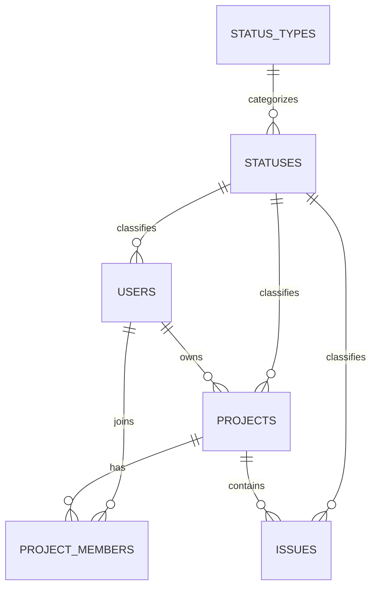
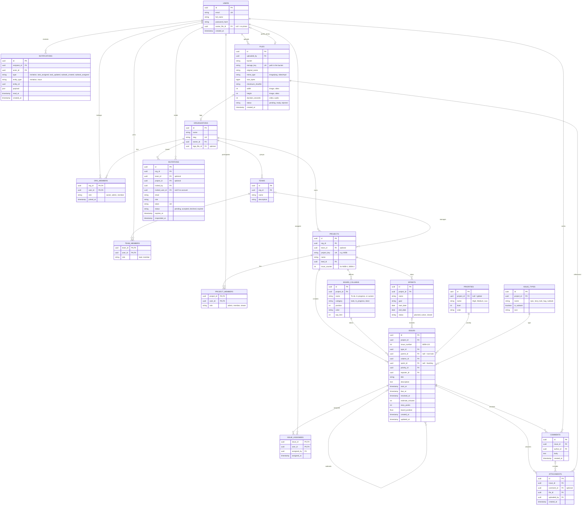

# Orbit database design

This document is a domain proposal for Orbit, not a description of the deployed database. The **Current decisions for Orbit** section is the source of truth; the diagram and the sections after it are an initial catalog of features and must be aligned before generating migrations.

## Conventions

- Primary and foreign keys are `integer` with identity, except join tables, which use composite keys.
- `PK` is primary key, `FK` foreign key, `UK` unique value.
- Points in time use `timestamptz`; PostgreSQL normalizes them as instants and the application works in UTC. Calendar dates (for example, a sprint start) use `date` and do not represent a UTC time.
- Files (photos, images, videos, PDFs) are not stored in the database: they live in object storage (S3, R2, GCS, MinIO) or on disk, and only the metadata and the path are stored here.

---

## Current decisions for Orbit

These decisions replace any incompatible example in the conceptual catalog further below.

### Personal installation; projects with members

There are no `ORGANIZATIONS`, `ORG_MEMBERS`, `TEAMS` or `TEAM_MEMBERS` tables.
Orbit is open source, and a project's "team" is the set of users who are members of it (`PROJECT_MEMBERS`); there is no intermediate team level.

- `PROJECTS.owner_user_id` identifies the project owner. Only the owner can delete the project and manage its members.
- `PROJECT_MEMBERS` (`project_id`, `user_id`, composite PK) lists who has access to the project. When a project is created, the owner is automatically inserted as the first member.
- **Access rule:** a user can see or modify a project, and everything under it (issues, comments, attachments), if and only if they appear in `PROJECT_MEMBERS` for that project. Every query filters by the session user, never by a user sent by the client.
- "Inviting" means adding an existing user (created from the Users module) as a member. There are no email invitations in the initial scope.
- Members have no role for now; if one is needed, a column is added to `PROJECT_MEMBERS` without changing the access rule.

Minimal approved model for users and project access:

### Issue catalogs

The values a user picks on an issue live in tables, and the interface only reads them (`GET /projects/:id/issue-options` and `GET /projects/:id/board`):

- **Status:** `BOARD_COLUMNS`, per project. Each project starts with To do, In progress and Done (`DEFAULT_BOARD_COLUMNS` in `@orbit/shared`). The category (`todo`, `in_progress`, `done`) is what controls `resolved_at`. This is not the same as `ISSUES.status_id`, which only marks the lifecycle (`ISSUE_ACTIVE`, `ISSUE_DELETED`).
- **Type:** `ISSUE_TYPES`, per project (Task, Story, Bug and Subtask when it is created). Only types with `is_subtask` can have a `parent_id`, and it is required for them. The parent must be an issue of the same project that is not a subtask (a single level). Deleting an issue deletes its subtasks.
- **Priority:** `PRIORITIES`, global (`project_id` is null). From most to least urgent: Urgent (1), Very high (2), High (3), Medium (4), Low (5) and Very low (6).
- **Difficulty:** `DIFFICULTIES`, global. Sizes XS, S, MD, LG and XL (level 1 to 5); `ISSUES.difficulty_id` is optional.

The seeded names of these catalogs are stored in Spanish; the interface translates them when they have not been renamed.

### Sprints, backlog and columns

- **Sprint:** `SPRINTS.status` is `planned`, `active` or `closed`. A partial unique index guarantees a single active sprint per project. Only a `planned` sprint can be deleted; a `closed` one cannot be edited or receive issues.
- **Backlog:** an issue without `sprint_id`. Subtasks always follow the sprint of their parent issue, so only root issues are planned.
- **Board:** with an active sprint it shows only its issues; without one, it shows the backlog issues (kanban mode).
- **Closing a sprint:** issues that are not in a `done` column go back to the backlog; finished ones stay in the sprint as history.
- **Columns:** each project manages its own (create, rename, reorder, work-in-progress limit). The category is chosen on creation and does not change. At least one `todo` and one `done` column must remain. When deleting a column you must say which column its issues move to.

### Comments

Any project member can comment on an issue. Only the author edits or deletes their comment. `COMMENTS` has no status, so deletion is permanent (unlike users, projects and issues, which use soft delete). Deleting a comment also deletes its attachments. If an issue is deleted, its comments stay in the database.

### Internal IDs and visible issue key

`integer` IDs generated by PostgreSQL are used, as in the current API. In `ISSUES`, `id` is the global internal PK. The readable identifier, for example `WEB-123`, is built from `PROJECTS.project_key` and a sequential `issue_number` within that project. `UNIQUE (project_id, issue_number)` applies.

The next `issue_number` must be assigned atomically inside the transaction that creates the issue (for example, by incrementing and returning a counter in `PROJECTS`). It is not computed with `MAX(issue_number) + 1`, because two concurrent creations could get the same number.

The `parent_id`, `reporter_id`, `issue_id` and other FKs keep pointing to internal IDs; the visible key does not replace the PK and is not used as an FK.

### Users, statuses and soft delete

The user keeps the identity fields the API already handles (`id`, `name` and `email`). In the database, the hash will be called `password_hash` to make clear it is not the original password; the application may keep calling the internal, already hashed value `password` until the model is renamed. Physical column names use `snake_case` (`status_key`, `created_at`, etc.).

`STATUS_TYPES` identifies which entity the statuses belong to (`user`, `project` or `issue`); `STATUSES` holds the statuses of each type. Tables use the text keys `status_type_key` and `status_key` (`varchar(25)`) and a composite FK to prevent assigning a project status to a user by mistake. The keys are stable uppercase identifiers, for example `USER_ACTIVE` or `PROJECT_ARCHIVED`; the visible name can change without changing the key. This allows filtering by type without depending on numeric IDs kept in sync between the code and the database.

Soft delete updates `status_key` to the `*_DELETED` status of the entity type and updates `updated_at`; `deleted_at` is not used. User queries exclude `USER_DELETED`. The email stays reserved by the unique constraint even after a soft delete.

### Time

Every column that represents a point in time (`created_at`, `updated_at`, `resolved_at`, etc.) must be `timestamptz`. PostgreSQL keeps the instant, not the original time zone. The API serializes and accepts instants in ISO 8601 with an explicit zone. Calendar dates such as `start_date`, `end_date`, and the issue `start_date` and `due_date` stay as `date`.

### Audit

Every table includes `created_at`, `updated_at`, `created_by_user_id` and `updated_by_user_id`. The timestamps record when operations happened; the user IDs identify who performed them. The audit IDs are nullable to allow records created by migrations or system processes. `updated_at` must be updated by the application on every modification; `DEFAULT now()` only sets its initial value.

### Implemented Drizzle schemas

The API has Drizzle schemas for `STATUS_TYPES`, `STATUSES`, `USERS`, `PROJECTS`, `PROJECT_MEMBERS`, `BOARD_COLUMNS`, `SPRINTS`, `PRIORITIES`, `DIFFICULTIES`, `ISSUE_TYPES`, `ISSUES`, `ISSUE_ASSIGNEES`, `COMMENTS`, `FILES`, `ATTACHMENTS`, `NOTIFICATIONS`, `MODULES` and `USER_PERMISSIONS`. They live in `apps/api/src/infrastructure/db/schema`.

All IDs are `integer` and all tables use the audit columns `created_at`, `updated_at`, `created_by_user_id` and `updated_by_user_id`. `created_by_user_id` and `updated_by_user_id` are nullable to allow system operations or migrations. Application code must keep `updated_at` current when modifying a record.

`ORGANIZATIONS`, `ORG_MEMBERS`, `TEAMS`, `TEAM_MEMBERS` and `INVITATIONS` are not created. Access to a project is based on `PROJECT_MEMBERS` and must be verified in the use cases and repositories.

`USERS`, `PROJECTS` and `ISSUES` reference statuses from the shared catalog; the stable keys are defined as enums in `packages/shared/src/enums/status.enum.ts`. The initial data is exported by `status-types.ts` and `statuses.ts`. The migration must insert those catalogs before the rows that reference them.

Having Drizzle schemas does not create or modify existing tables. Before using these tables in a database, a migration must be generated and reviewed (`pnpm --filter api migration:generate --name <name>`).

`PROJECTS.project_key` is a readable key, unique per owner (for example, `WEB`), different from `PROJECTS.id`. It forms the visible issue keys such as `WEB-123`; it does not replace the PK and is not used as an FK.

---

## Conceptual feature catalog

> The `TEAMS` and `TEAM_MEMBERS` entities in this catalog were discarded: a project's team is its `PROJECT_MEMBERS`.

The content below is a functional reference and must not be read as literal SQL: it keeps names and examples from the first design, including `uuid` IDs and relations to organizations that no longer apply. The current Drizzle schemas use the decisions described above: `integer` IDs, membership at project level only, and common audit columns.

---

## Entity-relationship diagram

> It renders on GitHub, GitLab, Notion, Obsidian, VS Code (with a Mermaid extension) and at https://mermaid.live

---

## 1. Users and organizations

### USERS
Person accounts of the system. A person has a single account and can belong to several organizations.

| Field | Type | Description |
|---|---|---|
| `id` | uuid PK | User identifier. |
| `email` | string UK | Sign-in email. Unique across the whole system; store it in lowercase. |
| `full_name` | string | Name shown on boards, comments and assignments. |
| `password_hash` | string | Password hash (argon2 or bcrypt). Never stored in plain text. It can be null if the user only signs in through an external provider (Google, SSO). |
| `avatar_file_id` | uuid FK | Points to `FILES`. It is the profile photo; null means there is none and an avatar with initials is shown. |
| `created_at` | timestamp | Registration date. |

### ORGANIZATIONS
Top-level workspace (the company or account). Everything else hangs from here.

| Field | Type | Description |
|---|---|---|
| `id` | uuid PK | Organization identifier. |
| `name` | string | Display name. |
| `slug` | string UK | Identifier for URLs, for example `acme` in `acme.myapp.com`. |
| `owner_id` | uuid FK | Owner user, with full control and billing. |
| `logo_file_id` | uuid FK | Organization logo in `FILES`. Optional. |

### ORG_MEMBERS
Join table between users and organizations. It defines who belongs to each organization and with what role.

| Field | Type | Description |
|---|---|---|
| `org_id` | uuid PK, FK | Organization. |
| `user_id` | uuid PK, FK | Member user. The `org_id` + `user_id` combination is unique. |
| `role` | string | `owner`, `admin` or `member`. Controls organization-level permissions. |
| `joined_at` | timestamp | When they joined (normally on accepting an invitation). |

---

## 2. Teams and projects

### TEAMS
Groups of people inside an organization (for example Backend, Design, QA).

| Field | Type | Description |
|---|---|---|
| `id` | uuid PK | Team identifier. |
| `org_id` | uuid FK | Organization it belongs to. |
| `name` | string | Team name. |
| `description` | string | Optional description. |

### TEAM_MEMBERS
Join table between teams and users.

| Field | Type | Description |
|---|---|---|
| `team_id` | uuid PK, FK | Team. |
| `user_id` | uuid PK, FK | Member user. |
| `role` | string | `lead` or `member`. |

### PROJECTS
Container for issues, columns, sprints and members. A project belongs to an organization and is optionally managed by a team.

| Field | Type | Description |
|---|---|---|
| `id` | uuid PK | Project identifier. |
| `org_id` | uuid FK | Owning organization. |
| `team_id` | uuid FK | Responsible team. Optional. |
| `project_key` | string UK | Short uppercase key, for example `WEB`. It forms the code of each issue (`WEB-123`). |
| `name` | string | Project name. |
| `lead_id` | uuid FK | Project lead user. |
| `issue_counter` | int | Last issue number used. Incremented atomically when creating an issue to generate `WEB-1`, `WEB-2`, etc. |

### PROJECT_MEMBERS
Join table between projects and users, with project-specific permissions.

| Field | Type | Description |
|---|---|---|
| `project_id` | uuid PK, FK | Project. |
| `user_id` | uuid PK, FK | User with access. |
| `role` | string | `admin`, `member` or `viewer` (read-only). |

---

## 3. Workflow and planning

### BOARD_COLUMNS
The dynamic sections of the board. Each project has its own, and users can create, rename and reorder as many as they want, in addition to To do, In progress and Done.

| Field | Type | Description |
|---|---|---|
| `id` | uuid PK | Column identifier. |
| `project_id` | uuid FK | Project it belongs to. |
| `name` | string | Free name chosen by the user (for example "In review", "Blocked"). |
| `category` | string | `todo`, `in_progress` or `done`. It is the semantic category: reports, burndown and the `resolved_at` field depend on it, not on the name. That way any column can be renamed without breaking anything. |
| `position` | int | Left-to-right order on the board. |
| `color` | string | Column color (hex or name). |
| `wip_limit` | int | Work-in-progress limit. Optional; null means no limit. |

### SPRINTS
Fixed-length iterations of the project.

| Field | Type | Description |
|---|---|---|
| `id` | uuid PK | Sprint identifier. |
| `project_id` | uuid FK | Project. |
| `name` | string | For example "Sprint 12". |
| `goal` | string | Sprint goal. |
| `start_date` | date | Start date. |
| `end_date` | date | End date. |
| `status` | string | `planned`, `active` or `closed`. Only one active sprint per project should be allowed. |

### PRIORITIES
Priority catalog. There can be a global catalog with per-project customizations.

| Field | Type | Description |
|---|---|---|
| `id` | uuid PK | Identifier. |
| `project_id` | uuid FK | Owning project. Null means a global priority available to everyone. |
| `name` | string | For example Critical, High, Medium, Low. |
| `level` | int | Numeric value for ordering (lower number = more urgent). |
| `color` | string | Indicator color. |

### ISSUE_TYPES
Task type catalog.

| Field | Type | Description |
|---|---|---|
| `id` | uuid PK | Identifier. |
| `project_id` | uuid FK | Owning project. |
| `name` | string | `epic`, `story`, `task`, `bug`, `subtask`, or whatever the user defines. |
| `is_subtask` | boolean | Marks the types that can only exist as children of another issue. |
| `icon` | string | Icon shown in lists and cards. |

---

## 4. Issues (tasks and subtasks)

### ISSUES
Central table. It stores tasks, stories, bugs, epics and subtasks. A subtask is just another row, with `parent_id` pointing to another issue, so it inherits comments, attachments and assignees without extra tables.

| Field | Type | Description |
|---|---|---|
| `id` | uuid PK | Internal identifier. |
| `project_id` | uuid FK | Project it belongs to. |
| `issue_number` | int | Sequential number within the project. Together with `project_key` it forms the visible code (`WEB-123`). Unique per project. |
| `type_id` | uuid FK | Issue type (task, bug, subtask…). |
| `parent_id` | uuid FK | Parent issue. Null means a root task; with a value it is a subtask (or a story inside an epic). |
| `column_id` | uuid FK | Current board column, that is, its status. |
| `sprint_id` | uuid FK | Assigned sprint. Null means it is in the backlog. |
| `priority_id` | uuid FK | Priority. |
| `reporter_id` | uuid FK | User who created the issue. |
| `title` | string | Short summary. |
| `description` | text | Detailed description (Markdown or rich-editor JSON). |
| `start_at` | timestamp | Planned start date and time. |
| `due_at` | timestamp | Planned deadline or end. |
| `resolved_at` | timestamp | Filled automatically when the issue enters a column with `category = done`, and cleared if it moves back. |
| `estimate_minutes` | int | Effort estimate in minutes. |
| `story_points` | int | Estimate in points (optional, for agile teams). |
| `board_position` | float | Position inside its column. It is a `float` to insert between two cards (average of the neighbors) without rewriting the whole column. |
| `created_at` | timestamp | Creation date. |
| `updated_at` | timestamp | Last modification. |

### ISSUE_ASSIGNEES
Join table that assigns users to tasks and subtasks (both are issues). It allows several assignees per issue.

| Field | Type | Description |
|---|---|---|
| `issue_id` | uuid PK, FK | Assigned issue. |
| `user_id` | uuid PK, FK | Assignee user. |
| `assigned_by` | uuid FK | Who made the assignment. Used in the notification text. |
| `assigned_at` | timestamp | When it was assigned. |

---

## 5. Collaboration and audit

### COMMENTS
Conversation inside an issue.

| Field | Type | Description |
|---|---|---|
| `id` | uuid PK | Identifier. |
| `issue_id` | uuid FK | Commented issue. |
| `author_id` | uuid FK | Author. |
| `body` | text | Comment content. |
| `created_at` | timestamp | Publication date. |

---

## 6. Files and media

### FILES
Central table of uploaded files: profile photos, logos, images, videos and documents. It only stores metadata; the content is in object storage.

| Field | Type | Description |
|---|---|---|
| `id` | uuid PK | Identifier. |
| `uploaded_by` | uuid FK | User who uploaded the file. |
| `bucket` | string | Bucket where it is stored. |
| `storage_key` | string UK | Object path inside the bucket, for example `orgs/ab12/issues/9f3c/screenshot.png`. |
| `original_name` | string | Original file name, to display and download it. |
| `mime_type` | string | Real file type (`image/png`, `video/mp4`, `application/pdf`). Validate by reading the content, not just the extension. |
| `size_bytes` | bigint | Size in bytes. Useful for limits and quotas. |
| `checksum_sha256` | string | Content fingerprint. It allows detecting duplicates and corrupt files. |
| `width` | int | Width in pixels (image and video). |
| `height` | int | Height in pixels (image and video). |
| `duration_seconds` | int | Duration (video and audio). |
| `status` | string | `pending` (URL issued, not yet confirmed), `ready` (verified) or `rejected` (failed validation or antivirus). |
| `created_at` | timestamp | Record creation date. |

### ATTACHMENTS
Link between a file and the issue (or comment) it was attached to. A file can be reused without being duplicated.

| Field | Type | Description |
|---|---|---|
| `id` | uuid PK | Identifier. |
| `issue_id` | uuid FK | Issue it is attached to. |
| `comment_id` | uuid FK | The specific comment, if the file was uploaded inside one. Optional. |
| `file_id` | uuid FK | File in `FILES`. |
| `uploaded_by` | uuid FK | Who attached it. |
| `created_at` | timestamp | Attachment date. |

---

## 7. Invitations and notifications

### INVITATIONS
Requests to join an organization, team or project.

| Field | Type | Description |
|---|---|---|
| `id` | uuid PK | Identifier. |
| `org_id` | uuid FK | Organization being invited to. |
| `team_id` | uuid FK | Specific team. Optional. |
| `project_id` | uuid FK | Specific project. Optional. |
| `invited_by` | uuid FK | User who sends the invitation. |
| `invited_user_id` | uuid FK | Invited user, if they already have an account. Null if they do not exist yet. |
| `email` | string | Email it was sent to. |
| `role` | string | Role they will have on accepting. |
| `token` | string UK | Random token of the acceptance link. Storing only its hash is good practice. |
| `status` | string | `pending`, `accepted`, `declined` or `expired`. |
| `expires_at` | timestamp | Expiration date. |
| `responded_at` | timestamp | When they accepted or declined. |

### NOTIFICATIONS
Each user's notification inbox. It is generic: it serves invitations and any event about issues.

| Field | Type | Description |
|---|---|---|
| `id` | uuid PK | Identifier. |
| `recipient_id` | uuid FK | User who receives the notification. |
| `actor_id` | uuid FK | User who caused the event. |
| `type` | string | `invitation`, `task_assigned`, `task_updated`, `subtask_created` or `subtask_assigned`. |
| `entity_type` | string | Type of the related object: `invitation` or `issue`. |
| `entity_id` | uuid | Identifier of the related object. It is not a real FK because it points to different tables depending on `entity_type`. |
| `payload` | json | Context to build the text: issue title, old and new value, project name, etc. |
| `read_at` | timestamp | Null means unread. |
| `created_at` | timestamp | When it was generated. |

---

## Key flows

**Create a subtask.** An issue is inserted with the parent's `parent_id` and a type with `is_subtask = true`. A `subtask_created` notification is generated for the parent's assignees.

**Assign users to a task or subtask.** A row is inserted into `ISSUE_ASSIGNEES` and a `task_assigned` or `subtask_assigned` notification is created for the assigned user.

**Move a card to another column.** `column_id` and `board_position` are updated. If the new column has `category = done`, `resolved_at` is filled; if the card leaves it, it is cleared. Assignees and the reporter are notified (`task_updated`).

**Invite a person.** The `INVITATIONS` row is created with its token and the email is sent. If the email already belongs to a user, an `invitation` notification is also created. On acceptance, it is marked `accepted` and the membership is inserted into `ORG_MEMBERS`, `TEAM_MEMBERS` or `PROJECT_MEMBERS` depending on the scope.

**Upload a file.** The backend creates the `FILES` row with `status = pending` and returns a presigned URL. The client uploads straight to the bucket and reports back; the backend verifies size and type, marks it `ready` and creates the `ATTACHMENTS` row. Thumbnail generation can be added later if the product needs it.

---

## Recommended indexes

| Table | Index | Purpose |
|---|---|---|
| `ISSUES` | `(project_id, issue_number)` unique | Look up `WEB-123` and avoid duplicates. |
| `ISSUES` | `(column_id, board_position)` | Draw the board in order. |
| `ISSUES` | `(parent_id)` | List subtasks. |
| `ISSUES` | `(sprint_id)` | Contents of a sprint. |
| `ISSUES` | `(project_id, due_at)` | Due-date and calendar views. |
| `ISSUE_ASSIGNEES` | `(user_id)` | "My tasks". |
| `NOTIFICATIONS` | `(recipient_id, read_at, created_at desc)` | Counter and list of unread. |
| `INVITATIONS` | `(email, status)` and `(token)` | Find pending invitations and validate the link. |
| `ATTACHMENTS` | `(issue_id)` | Attachments of an issue. |
| `FILES` | `(checksum_sha256)` | Detect duplicates. |

## Suggested constraints

- `ISSUES`: an issue cannot be its own parent (`parent_id <> id`) and, if the type is a subtask, `parent_id` is required.
- `ISSUES`: the parent and the child must belong to the same `project_id`.
- `SPRINTS`: `end_date >= start_date`, and at most one sprint with `status = active` per project.
- `BOARD_COLUMNS`: `(project_id, name)` unique and at least one column per category.
- `INVITATIONS`: a single `pending` invitation per combination of email and scope.
