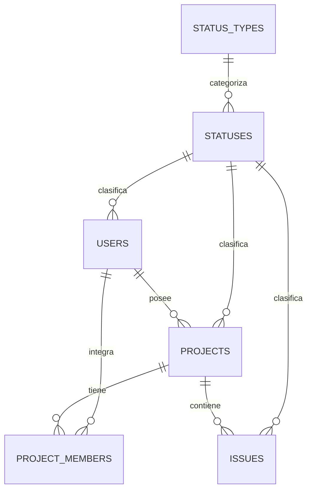
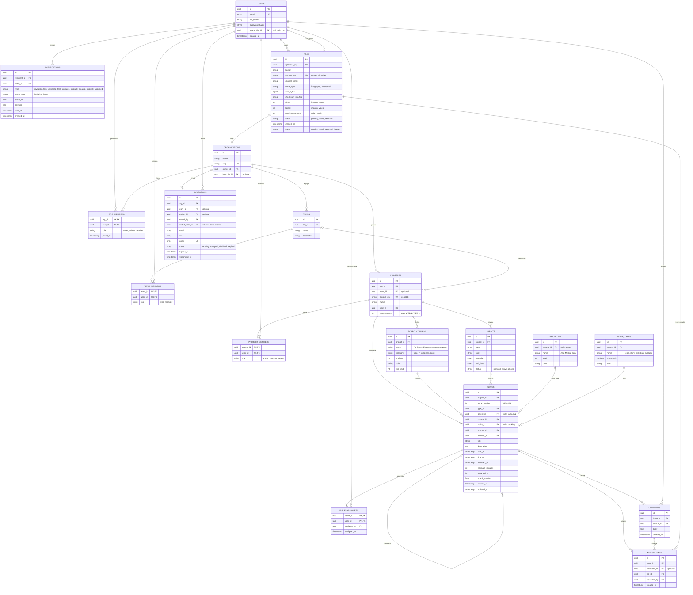

# Diseño de base de datos para Orbit

Este documento es una propuesta de dominio para Orbit, no una descripción de la base ya desplegada. La sección **Decisiones vigentes para Orbit** es la fuente de verdad; el diagrama y las secciones posteriores son un catálogo inicial de funcionalidades y deben alinearse antes de generar migraciones.

## Convenciones

- Las llaves primarias y foráneas son `integer` con identity, salvo tablas puente que usan llaves compuestas.
- `PK` es llave primaria, `FK` llave foránea, `UK` valor único.
- Los instantes de tiempo usan `timestamptz`; PostgreSQL los normaliza como instantes y la aplicación opera en UTC. Las fechas de calendario (por ejemplo, inicio de sprint) usan `date` y no representan una hora UTC.
- Los archivos (fotos, imágenes, videos, PDF) no se guardan en la base de datos: viven en un almacenamiento de objetos (S3, R2, GCS, MinIO) y aquí solo se guardan los metadatos y la ruta.

---

## Decisiones vigentes para Orbit

Estas decisiones reemplazan cualquier ejemplo incompatible que aparezca en el
catálogo conceptual más abajo.

### Instalación personal; proyectos con miembros

No se crean tablas `ORGANIZATIONS`, `ORG_MEMBERS`, `TEAMS` ni `TEAM_MEMBERS`.
Orbit es open source y el "equipo" de un proyecto es el conjunto de usuarios que
son miembros de él (`PROJECT_MEMBERS`); no existe un nivel de equipo intermedio.

- `PROJECTS.owner_user_id` identifica al propietario del proyecto. Solo el
  propietario puede borrarlo y gestionar sus miembros.
- `PROJECT_MEMBERS` (`project_id`, `user_id`, PK compuesta) lista a quienes
  tienen acceso al proyecto. Al crear un proyecto, el propietario se inserta
  automáticamente como primer miembro.
- **Regla de acceso:** un usuario puede ver o modificar un proyecto, y todo lo
  que cuelga de él (issues, comentarios, adjuntos), si y solo si aparece en
  `PROJECT_MEMBERS` de ese proyecto. Cada consulta filtra por el usuario de la
  sesión; nunca por un usuario enviado por el cliente.
- "Invitar" significa añadir a un usuario ya existente (creado desde el módulo
  Usuarios) como miembro. No hay invitaciones por correo en el alcance inicial.
- Los miembros no tienen rol por ahora; si hace falta, se añade una columna a
  `PROJECT_MEMBERS` sin cambiar la regla de acceso.

Modelo mínimo aprobado para usuarios y acceso a proyectos:

### Catálogos de issues

Los valores que el usuario elige en un issue viven en tablas y la interfaz solo
los consulta (`GET /projects/:id/issue-options` y `GET /projects/:id/board`):

- **Estado:** `BOARD_COLUMNS`, por proyecto. Cada proyecto nace con Por hacer,
  En curso y Finalizada (`DEFAULT_BOARD_COLUMNS` en `@orbit/shared`). La
  categoría (`todo`, `in_progress`, `done`) es la que controla `resolved_at`.
  No es lo mismo que `ISSUES.status_id`, que solo marca el ciclo de vida
  (`ISSUE_ACTIVE`, `ISSUE_DELETED`).
- **Tipo:** `ISSUE_TYPES`, por proyecto (Tarea, Historia, Bug y Subtarea al
  crearlo). Solo los tipos con `is_subtask` pueden tener `parent_id`, y es
  obligatorio en ellos. El padre debe ser un issue del mismo proyecto que no
  sea subtarea (un solo nivel). Al borrar un issue se borran sus subtareas.
- **Prioridad:** `PRIORITIES`, global (`project_id` nulo). De mayor a menor
  urgencia: Urgencia (1), Muy alta (2), Alta (3), Media (4), Baja (5) y
  Muy baja (6).
- **Dificultad:** `DIFFICULTIES`, global. Tallas XS, S, MD, LG y XL
  (nivel 1 a 5); `ISSUES.difficulty_id` es opcional.

### Sprints, backlog y columnas

- **Sprint:** `SPRINTS.status` es `planned`, `active` o `closed`. Un índice
  único parcial garantiza un solo sprint activo por proyecto. Solo se puede
  eliminar un sprint `planned`; uno `closed` no se edita ni recibe issues.
- **Backlog:** un issue sin `sprint_id`. Las subtareas siempre siguen el sprint
  de su issue padre, así que solo los issues raíz se planifican.
- **Tablero:** con un sprint activo muestra solo sus issues; sin sprint activo,
  muestra los del backlog (modo kanban).
- **Completar un sprint:** los issues que no están en una columna `done`
  vuelven al backlog; los terminados quedan en el sprint como historial.
- **Columnas:** cada proyecto las administra (crear, renombrar, reordenar,
  límite de trabajo en curso). La categoría se elige al crear y no cambia. Debe
  quedar al menos una columna `todo` y una `done`. Al eliminar una columna hay
  que indicar a cuál pasan sus issues.

### Comentarios

Cualquier miembro del proyecto puede comentar un issue. Solo el autor edita o
borra su comentario. `COMMENTS` no tiene estado, así que el borrado es
definitivo (a diferencia de usuarios, proyectos e issues, que usan borrado
lógico). Si se borra un issue, sus comentarios quedan en la base.

### IDs internos y clave visible de los issues

Se usan IDs `integer` generados por PostgreSQL, como en la API actual. En
`ISSUES`, `id` es la PK interna global. El identificador legible, por ejemplo
`WEB-123`, se forma con `PROJECTS.project_key` y un `issue_number` secuencial
dentro de ese proyecto. Se aplica `UNIQUE (project_id, issue_number)`.

El siguiente `issue_number` debe asignarse de forma atómica dentro de la
transacción que crea el issue (por ejemplo, incrementando y devolviendo un
contador en `PROJECTS`). No se calcula con `MAX(issue_number) + 1`, porque dos
creaciones concurrentes podrían obtener el mismo número.

Las FK `parent_id`, `reporter_id`, `issue_id` y demás siguen apuntando a IDs
internos; el código visible no sustituye la PK ni se usa como FK.

### Usuarios, estados y borrado lógico

El usuario conserva los campos de identidad que ya maneja la API (`id`, `name`
y `email`). En la base, el hash se llamará `password_hash` para dejar claro que
no es la contraseña original; la aplicación puede seguir llamando `password` al
valor interno ya hasheado hasta que se renombre el modelo. Los nombres físicos
de columnas usan `snake_case` (`status_key`, `created_at`, etc.). `last_name`
solo se agrega cuando el caso de uso y la API realmente recojan ese dato.

`STATUS_TYPES` identifica a qué entidad pertenecen los estados (`user`,
`project` o `issue`); `STATUSES` contiene los estados de cada tipo. Las tablas
usan claves textuales `status_type_key` y `status_key` (`varchar(25)`) y una FK
compuesta para impedir asignar por error un estado de proyecto a un usuario. Las
claves son identificadores estables en mayúsculas, por ejemplo `USER_ACTIVE` o
`PROJECT_ARCHIVED`; el nombre visible puede cambiar sin modificar la clave.
Así se puede filtrar por tipo sin depender de IDs numéricos sincronizados entre
el código y la base.

El borrado lógico actualiza `status_key` al estado `*_DELETED` del tipo de
entidad y actualiza `updated_at`; no se usa `deleted_at`. Las consultas de
usuarios excluyen `USER_DELETED`. El correo permanece reservado por la
restricción única incluso después del borrado lógico.

### Tiempo

Toda columna que representa un instante (`created_at`, `updated_at`, `due_at`,
`resolved_at`, etc.) debe ser `timestamptz`. PostgreSQL conserva el instante,
no la zona horaria original. La API serializa y acepta instantes en ISO 8601
con zona explícita; las fechas como `start_date` y `end_date` permanecen como
`date`.

### Auditoría

Todas las tablas iniciales incluyen `created_at`, `updated_at`,
`created_by_user_id` y `updated_by_user_id`. Los timestamps registran cuándo
ocurrieron las operaciones; los IDs de usuario identifican quién las realizó.
Los IDs de auditoría son nullable para permitir registros iniciales creados por
migraciones o procesos del sistema. `updated_at` debe actualizarse desde la
aplicación en cada modificación; `DEFAULT now()` solo establece su valor
inicial.

### Schemas Drizzle implementados

La API tiene schemas Drizzle para `STATUS_TYPES`, `STATUSES`, `USERS`,
`PROJECTS`, `PROJECT_MEMBERS`, `BOARD_COLUMNS`, `SPRINTS`, `PRIORITIES`, `ISSUE_TYPES`, `ISSUES`,
`ISSUE_ASSIGNEES`, `COMMENTS`, `FILES`, `ATTACHMENTS` y `NOTIFICATIONS`. Se ubican en
`apps/api/src/infrastructure/db/schema`.

Todos los IDs son `integer` y todas las tablas usan las columnas de auditoría
`created_at`, `updated_at`, `created_by_user_id` y `updated_by_user_id`.
`created_by_user_id` y `updated_by_user_id` son nullable para permitir
operaciones del sistema o migraciones. El código de aplicación debe mantener
`updated_at` al modificar un registro.

No se crean `ORGANIZATIONS`, `ORG_MEMBERS`, `TEAMS`, `TEAM_MEMBERS` ni
`INVITATIONS`. El acceso a un proyecto se basa en `PROJECT_MEMBERS` y debe
verificarse en los casos de uso/repositorios.

`USERS`, `PROJECTS` e `ISSUES` referencian estados del catálogo
compartido; las claves estables están definidas como enums en
`packages/shared/src/enums/status.enum.ts`. Los datos iniciales se exportan por
`status-types.ts` y `statuses.ts`. La migración debe insertar esos catálogos
antes de filas que los referencien.

Tener schemas Drizzle no crea ni modifica tablas existentes. Antes de usar
estas tablas en una base hace falta generar y revisar la migración.

`PROJECTS.project_key` es una clave legible y única por propietario (por
ejemplo, `WEB`), distinta de `PROJECTS.id`. Se propone para formar claves
visibles de issues como `WEB-123`; no reemplaza la PK ni se usa como FK.

---

## Catálogo conceptual de funcionalidades

> Las entidades `TEAMS` y `TEAM_MEMBERS` de este catálogo quedaron descartadas:
> el equipo de un proyecto son sus `PROJECT_MEMBERS`.

El contenido siguiente es una referencia funcional y no debe interpretarse
como SQL literal: conserva nombres y ejemplos del primer diseño, incluyendo
IDs `uuid` y relaciones con organizaciones que ya no aplican. Los schemas
Drizzle actuales usan las decisiones descritas arriba: IDs `integer`, membresías solo
a nivel de proyecto y auditoría común.

---

## Diagrama entidad-relación

> Se renderiza en GitHub, GitLab, Notion, Obsidian, VS Code (con extensión Mermaid) y en https://mermaid.live

---

## 1. Usuarios y organizaciones

### USERS
Cuentas de persona del sistema. Una persona tiene una sola cuenta y puede pertenecer a varias organizaciones.

| Campo | Tipo | Descripción |
|---|---|---|
| `id` | uuid PK | Identificador del usuario. |
| `email` | string UK | Correo de acceso. Único en todo el sistema; guardarlo en minúsculas. |
| `full_name` | string | Nombre para mostrar en tableros, comentarios y asignaciones. |
| `password_hash` | string | Hash de la contraseña (argon2 o bcrypt). Nunca se guarda en texto plano. Puede ser nulo si solo usa inicio de sesión externo (Google, SSO). |
| `avatar_file_id` | uuid FK | Apunta a `FILES`. Es la foto de perfil; nulo significa que no tiene y se muestra un avatar con iniciales. |
| `created_at` | timestamp | Fecha de registro. |

### ORGANIZATIONS
Espacio de trabajo de más alto nivel (la empresa o cuenta). Todo lo demás cuelga de aquí.

| Campo | Tipo | Descripción |
|---|---|---|
| `id` | uuid PK | Identificador de la organización. |
| `name` | string | Nombre visible. |
| `slug` | string UK | Identificador para URLs, por ejemplo `acme` en `acme.miapp.com`. |
| `owner_id` | uuid FK | Usuario propietario, con control total y facturación. |
| `logo_file_id` | uuid FK | Logo de la organización en `FILES`. Opcional. |

### ORG_MEMBERS
Tabla puente entre usuarios y organizaciones. Define quién pertenece a cada organización y con qué rol.

| Campo | Tipo | Descripción |
|---|---|---|
| `org_id` | uuid PK, FK | Organización. |
| `user_id` | uuid PK, FK | Usuario miembro. La combinación `org_id` + `user_id` es única. |
| `role` | string | `owner`, `admin` o `member`. Controla permisos a nivel organización. |
| `joined_at` | timestamp | Cuándo entró (normalmente al aceptar una invitación). |

---

## 2. Equipos y proyectos

### TEAMS
Agrupaciones de personas dentro de una organización (por ejemplo Backend, Diseño, QA).

| Campo | Tipo | Descripción |
|---|---|---|
| `id` | uuid PK | Identificador del equipo. |
| `org_id` | uuid FK | Organización a la que pertenece. |
| `name` | string | Nombre del equipo. |
| `description` | string | Descripción opcional. |

### TEAM_MEMBERS
Tabla puente entre equipos y usuarios.

| Campo | Tipo | Descripción |
|---|---|---|
| `team_id` | uuid PK, FK | Equipo. |
| `user_id` | uuid PK, FK | Usuario integrante. |
| `role` | string | `lead` o `member`. |

### PROJECTS
Contenedor de issues, columnas, sprints y miembros. Un proyecto pertenece a una organización y opcionalmente lo administra un equipo.

| Campo | Tipo | Descripción |
|---|---|---|
| `id` | uuid PK | Identificador del proyecto. |
| `org_id` | uuid FK | Organización dueña. |
| `team_id` | uuid FK | Equipo responsable. Opcional. |
| `project_key` | string UK | Clave corta en mayúsculas, por ejemplo `WEB`. Forma el código de cada issue (`WEB-123`). |
| `name` | string | Nombre del proyecto. |
| `lead_id` | uuid FK | Usuario líder del proyecto. |
| `issue_counter` | int | Último número de issue usado. Se incrementa de forma atómica al crear un issue para generar `WEB-1`, `WEB-2`, etc. |

### PROJECT_MEMBERS
Tabla puente entre proyectos y usuarios, con permisos propios del proyecto.

| Campo | Tipo | Descripción |
|---|---|---|
| `project_id` | uuid PK, FK | Proyecto. |
| `user_id` | uuid PK, FK | Usuario con acceso. |
| `role` | string | `admin`, `member` o `viewer` (solo lectura). |

---

## 3. Flujo de trabajo y planificación

### BOARD_COLUMNS
Las secciones dinámicas del tablero. Cada proyecto tiene las suyas, y los usuarios pueden crear, renombrar y reordenar las que quieran, además de Por Hacer, En Curso y Finalizada.

| Campo | Tipo | Descripción |
|---|---|---|
| `id` | uuid PK | Identificador de la columna. |
| `project_id` | uuid FK | Proyecto al que pertenece. |
| `name` | string | Nombre libre elegido por el usuario (por ejemplo "En revisión", "Bloqueada"). |
| `category` | string | `todo`, `in_progress` o `done`. Es la categoría semántica: los reportes, el burndown y el campo `resolved_at` dependen de ella, no del nombre. Así se puede renombrar cualquier columna sin romper nada. |
| `position` | int | Orden de izquierda a derecha en el tablero. |
| `color` | string | Color de la columna (hex o nombre). |
| `wip_limit` | int | Límite de trabajo en curso. Opcional; nulo significa sin límite. |

### SPRINTS
Iteraciones de tiempo fijo del proyecto.

| Campo | Tipo | Descripción |
|---|---|---|
| `id` | uuid PK | Identificador del sprint. |
| `project_id` | uuid FK | Proyecto. |
| `name` | string | Por ejemplo "Sprint 12". |
| `goal` | string | Objetivo del sprint. |
| `start_date` | date | Fecha de inicio. |
| `end_date` | date | Fecha de fin. |
| `status` | string | `planned`, `active` o `closed`. Conviene permitir solo un sprint activo por proyecto. |

### PRIORITIES
Catálogo de prioridades. Se puede tener un catálogo global y permitir personalizaciones por proyecto.

| Campo | Tipo | Descripción |
|---|---|---|
| `id` | uuid PK | Identificador. |
| `project_id` | uuid FK | Proyecto dueño. Nulo significa prioridad global disponible para todos. |
| `name` | string | Por ejemplo Crítica, Alta, Media, Baja. |
| `level` | int | Valor numérico para ordenar (menor número = más urgente). |
| `color` | string | Color del indicador. |

### ISSUE_TYPES
Catálogo de tipos de tarea.

| Campo | Tipo | Descripción |
|---|---|---|
| `id` | uuid PK | Identificador. |
| `project_id` | uuid FK | Proyecto dueño. |
| `name` | string | `epic`, `story`, `task`, `bug`, `subtask`, o los que defina el usuario. |
| `is_subtask` | boolean | Marca los tipos que solo pueden existir como hijos de otro issue. |
| `icon` | string | Ícono para mostrar en listas y tarjetas. |

---

## 4. Issues (tareas y subtareas)

### ISSUES
Tabla central. Guarda tareas, historias, bugs, épicas y subtareas. Una subtarea es una fila más, con `parent_id` apuntando a otro issue, así hereda comentarios, adjuntos y asignados sin tablas adicionales.

| Campo | Tipo | Descripción |
|---|---|---|
| `id` | uuid PK | Identificador interno. |
| `project_id` | uuid FK | Proyecto al que pertenece. |
| `issue_number` | int | Número secuencial dentro del proyecto. Junto con `project_key` forma el código visible (`WEB-123`). Único por proyecto. |
| `type_id` | uuid FK | Tipo de issue (tarea, bug, subtarea…). |
| `parent_id` | uuid FK | Issue padre. Nulo significa tarea raíz; con valor significa subtarea (o historia dentro de una épica). |
| `column_id` | uuid FK | Columna actual del tablero, es decir, su estado. |
| `sprint_id` | uuid FK | Sprint asignado. Nulo significa que está en el backlog. |
| `priority_id` | uuid FK | Prioridad. |
| `reporter_id` | uuid FK | Usuario que creó el issue. |
| `title` | string | Resumen corto. |
| `description` | text | Descripción detallada (Markdown o JSON de editor enriquecido). |
| `start_at` | timestamp | Fecha y hora de inicio planificada. |
| `due_at` | timestamp | Fecha límite o de fin planificada. |
| `resolved_at` | timestamp | Se llena automáticamente cuando el issue entra a una columna con `category = done`, y se vacía si regresa. |
| `estimate_minutes` | int | Estimación de esfuerzo en minutos. |
| `story_points` | int | Estimación en puntos (opcional, para equipos ágiles). |
| `board_position` | float | Posición dentro de su columna. Es `float` para insertar entre dos tarjetas (promedio de vecinos) sin reescribir toda la columna. |
| `created_at` | timestamp | Fecha de creación. |
| `updated_at` | timestamp | Última modificación. |

### ISSUE_ASSIGNEES
Tabla puente que asigna usuarios a tareas y a subtareas (ambas son issues). Permite varios responsables por issue.

| Campo | Tipo | Descripción |
|---|---|---|
| `issue_id` | uuid PK, FK | Issue asignado. |
| `user_id` | uuid PK, FK | Usuario responsable. |
| `assigned_by` | uuid FK | Quién hizo la asignación. Se usa en el texto de la notificación. |
| `assigned_at` | timestamp | Cuándo se asignó. |

---

## 5. Colaboración y auditoría

### COMMENTS
Conversación dentro de un issue.

| Campo | Tipo | Descripción |
|---|---|---|
| `id` | uuid PK | Identificador. |
| `issue_id` | uuid FK | Issue comentado. |
| `author_id` | uuid FK | Autor. |
| `body` | text | Contenido del comentario. |
| `created_at` | timestamp | Fecha de publicación. |

---

## 6. Archivos y multimedia

### FILES
Tabla central de archivos subidos: fotos de perfil, logos, imágenes, videos y documentos. Solo guarda metadatos; el contenido está en el almacenamiento de objetos.

| Campo | Tipo | Descripción |
|---|---|---|
| `id` | uuid PK | Identificador. |
| `uploaded_by` | uuid FK | Usuario que subió el archivo. |
| `bucket` | string | Bucket donde está guardado. |
| `storage_key` | string UK | Ruta del objeto dentro del bucket, por ejemplo `orgs/ab12/issues/9f3c/captura.png`. |
| `original_name` | string | Nombre original del archivo, para mostrarlo y descargarlo. |
| `mime_type` | string | Tipo real del archivo (`image/png`, `video/mp4`, `application/pdf`). Validar leyendo el contenido, no solo la extensión. |
| `size_bytes` | bigint | Tamaño en bytes. Sirve para límites y cuotas. |
| `checksum_sha256` | string | Huella del contenido. Permite detectar duplicados y archivos corruptos. |
| `width` | int | Ancho en píxeles (imagen y video). |
| `height` | int | Alto en píxeles (imagen y video). |
| `duration_seconds` | int | Duración (video y audio). |
| `status` | string | `pending` (URL emitida, aún sin confirmar), `ready` (verificado) o `rejected` (no pasó validación o antivirus). |
| `created_at` | timestamp | Fecha de creación del registro. |
| `status` | string | `pending`, `ready`, `rejected`; el ciclo de archivos queda separado del catálogo actual de usuarios, equipos, proyectos e issues. |

### ATTACHMENTS
Enlace entre un archivo y el issue (o comentario) donde se adjuntó. Un archivo puede reutilizarse sin duplicarse.

| Campo | Tipo | Descripción |
|---|---|---|
| `id` | uuid PK | Identificador. |
| `issue_id` | uuid FK | Issue al que se adjunta. |
| `comment_id` | uuid FK | Comentario específico, si el archivo se subió dentro de uno. Opcional. |
| `file_id` | uuid FK | Archivo en `FILES`. |
| `uploaded_by` | uuid FK | Quién lo adjuntó. |
| `created_at` | timestamp | Fecha del adjunto. |

---

## 7. Invitaciones y notificaciones

### INVITATIONS
Solicitudes para unirse a una organización, equipo o proyecto.

| Campo | Tipo | Descripción |
|---|---|---|
| `id` | uuid PK | Identificador. |
| `org_id` | uuid FK | Organización a la que se invita. |
| `team_id` | uuid FK | Equipo específico. Opcional. |
| `project_id` | uuid FK | Proyecto específico. Opcional. |
| `invited_by` | uuid FK | Usuario que envía la invitación. |
| `invited_user_id` | uuid FK | Usuario invitado, si ya tiene cuenta. Nulo si todavía no existe. |
| `email` | string | Correo al que se envió. |
| `role` | string | Rol que tendrá al aceptar. |
| `token` | string UK | Token aleatorio del enlace de aceptación. Guardar solo su hash es una buena práctica. |
| `status` | string | `pending`, `accepted`, `declined` o `expired`. |
| `expires_at` | timestamp | Fecha de vencimiento. |
| `responded_at` | timestamp | Cuándo aceptó o rechazó. |

### NOTIFICATIONS
Bandeja de notificaciones de cada usuario. Es genérica: sirve para invitaciones y para cualquier evento sobre issues.

| Campo | Tipo | Descripción |
|---|---|---|
| `id` | uuid PK | Identificador. |
| `recipient_id` | uuid FK | Usuario que recibe la notificación. |
| `actor_id` | uuid FK | Usuario que provocó el evento. |
| `type` | string | `invitation`, `task_assigned`, `task_updated`, `subtask_created` o `subtask_assigned`. |
| `entity_type` | string | Tipo de objeto relacionado: `invitation` o `issue`. |
| `entity_id` | uuid | Identificador del objeto relacionado. No es FK real porque apunta a tablas distintas según `entity_type`. |
| `payload` | json | Contexto para armar el texto: título del issue, valor anterior y nuevo, nombre del proyecto, etc. |
| `read_at` | timestamp | Nulo significa no leída. |
| `created_at` | timestamp | Cuándo se generó. |

---

## Flujos clave

**Crear una subtarea.** Se inserta un issue con `parent_id` del padre y un tipo con `is_subtask = true`. Se genera una notificación `subtask_created` para los asignados del padre.

**Asignar usuarios a una tarea o subtarea.** Se inserta una fila en `ISSUE_ASSIGNEES` y se crea una notificación `task_assigned` o `subtask_assigned` para el usuario asignado.

**Mover una tarjeta de columna.** Se actualiza `column_id` y `board_position`. Si la nueva columna tiene `category = done`, se llena `resolved_at`; si sale de ella, se vacía. Se notifica a los asignados y al reportador (`task_updated`).

**Invitar a una persona.** Se crea la fila en `INVITATIONS` con su token y se envía el correo. Si el correo ya pertenece a un usuario, también se crea una notificación `invitation`. Al aceptar, se marca `accepted` y se inserta la membresía en `ORG_MEMBERS`, `TEAM_MEMBERS` o `PROJECT_MEMBERS` según el alcance.

**Subir un archivo.** El backend crea la fila en `FILES` con `status = pending` y entrega una URL prefirmada. El cliente sube directo al bucket y avisa; el backend verifica tamaño y tipo, marca `ready` y crea el `ATTACHMENTS`. La generación de miniaturas puede incorporarse después si el producto la necesita.

---

## Índices recomendados

| Tabla | Índice | Para qué |
|---|---|---|
| `ISSUES` | `(project_id, issue_number)` único | Buscar `WEB-123` y evitar duplicados. |
| `ISSUES` | `(column_id, board_position)` | Pintar el tablero ordenado. |
| `ISSUES` | `(parent_id)` | Listar subtareas. |
| `ISSUES` | `(sprint_id)` | Contenido de un sprint. |
| `ISSUES` | `(project_id, due_at)` | Vistas de vencimientos y calendario. |
| `ISSUE_ASSIGNEES` | `(user_id)` | "Mis tareas". |
| `NOTIFICATIONS` | `(recipient_id, read_at, created_at desc)` | Contador y lista de no leídas. |
| `INVITATIONS` | `(email, status)` y `(token)` | Buscar invitaciones pendientes y validar el enlace. |
| `ATTACHMENTS` | `(issue_id)` | Adjuntos de un issue. |
| `FILES` | `(checksum_sha256)` | Detectar duplicados. |

## Restricciones sugeridas

- `ISSUES`: un issue no puede ser su propio padre (`parent_id <> id`) y, si el tipo es subtarea, `parent_id` es obligatorio.
- `ISSUES`: el padre y el hijo deben pertenecer al mismo `project_id`.
- `SPRINTS`: `end_date >= start_date`, y a lo mucho un sprint con `status = active` por proyecto.
- `BOARD_COLUMNS`: `(project_id, name)` único y al menos una columna por categoría.
- `INVITATIONS`: una sola invitación `pending` por combinación de correo y alcance.